

  

    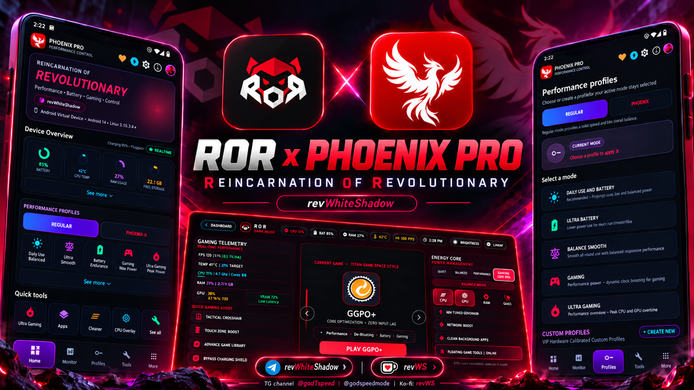
  

——
  

    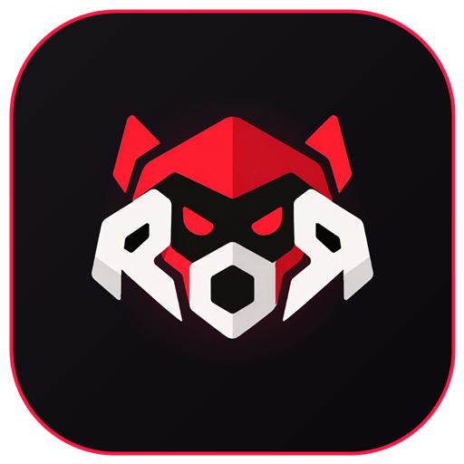
    &nbsp;&nbsp;&nbsp;&nbsp;&nbsp;&nbsp;&nbsp;&nbsp;&nbsp;&nbsp;&nbsp;&nbsp;
    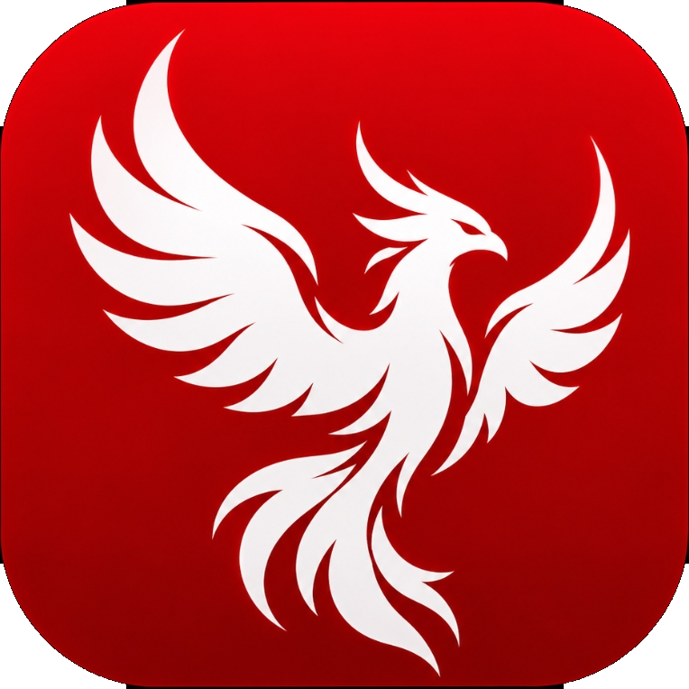
  

  # ROR | Reincarnation of Revolutionary
  ### Android Game Launcher, Kernel Manager & Gaming Optimization Tools

  

    <em>The next-generation open-core esports console, dynamic kernel governor manager, and mobile gaming optimization platform for Android.</em>
  

 
  

    
    
    
    
  

  

    
    
    
    
  

  ---

---

## ⚠️ ROR | DISTRIBUTION POLICY

 

**🔴 ORIGINAL BUILDS • OFFICIAL LINKS ONLY**

All YouTubers, websites, and creators **MUST use the official GitHub Releases link** when sharing the original ROR APK.

**[⬇️ DOWNLOAD OFFICIAL ROR](https://github.com/revws/ror/releases)**

⚠️ Copyright-infringing redistribution may result in **DMCA takedown without prior warning.**

---

**🟢 CREATE YOUR OWN VERSION**

`FORK` → `MODIFY` → `BUILD` → `SHARE`

Build and distribute your own modified version anywhere, subject to the project's license.

**[⑂ FORK THE SOURCE](https://github.com/revws/ror/fork)**

---

**🌐 OFFICIAL DISTRIBUTION & COMMUNITY**

**Distributor:** [magiskmodule.gitlab.io](https://magiskmodule.gitlab.io/magisk-modules-repo/ror-android-game-launcher-and-kernel-manager/)

**Telegram:** [@GodTspeed](https://t.me/GodTspeed) • [@godspeedmode](https://t.me/godspeedmode)

**Developer:** [@revWhiteShadow](https://github.com/revws)

 

© 2026 revWhiteShadow | REINCARNATION OF REVOLUTIONARY

---

  **[ Overview ](#1-project-overview)** •
  **[ Features Guide (features.md) ](features.md)** •
  **[ Game Space ](#5-game-space)** •
  **[ Kernel Tuning ](#7-kernel-tuning)** •
  **[ Screenshots ](#12-screenshots)** •
  **[ Installation ](#15-installation)** •
  **[ Whitepaper (articel.md) ](articel.md)**

---

> 🎮 **Complete Features Catalog**: For an exhaustive technical breakdown of all 21 Armory tools, Phoenix Pro engines, 4 Gaming Profiles, Canvas Vector banners, and kernel tuning nodes, read [features.md](features.md) (or [featuers.md](featuers.md)).
>
> 📖 **In-Depth Technical Whitepaper**: For detailed architecture diagrams, sysfs governor mechanics, DVFS benchmarks, and competitor comparisons, read our comprehensive article in [articel.md](articel.md).

---

## Table of Contents
1. [Project Overview](#1-project-overview)
2. [ROR Branding & Visual Identity](#2-ror-branding--visual-identity)
3. [Phoenix Premium System](#3-phoenix-premium-system)
4. [Main Features](#4-main-features)
5. [Game Space: Landscape Esports Console](#5-game-space)
6. [Regular and Phoenix Gaming Profiles](#6-regular-and-phoenix-gaming-profiles)
7. [Kernel Tuning & Sysfs Interface](#7-kernel-tuning)
8. [CPU & GPU Management](#8-cpugpu-management)
9. [Gaming Optimization Armory](#9-gaming-optimization-armory)
10. [Battery and Charging Cooldown](#10-battery-and-charging-cooldown)
11. [Monitoring and Telemetry](#11-monitoring-and-telemetry)
12. [Screenshots & Visual Gallery](#12-screenshots)
13. [Android Compatibility](#13-android-compatibility)
14. [Root & Shizuku Requirements](#14-root--shizuku-requirements)
15. [Installation](#15-installation)
16. [GPL-3.0 License](#16-gpl-30-license)
17. [Frequently Asked Questions (FAQ)](#17-frequently-asked-questions)
18. [Developer Information & Credits](#18-developer-information--credits)
19. [Official Links](#19-official-links)

---

## 1. Project Overview

**ROR (Reincarnation of Revolutionary)** is an advanced Android gaming environment engineered to overcome stock operating system bottlenecks, thermal throttling, and scheduler jitter. Standard Android ROMs prioritize generic battery-saving algorithms that throttle CPU and GPU frequencies abruptly under prolonged loads. ROR reclaims complete hardware control, giving mobile gamers, esports competitors, and power users the tools to sustain peak 60, 90, 120, and 144 FPS framerates with deterministic frame pacing.

ROR operates as both an interactive esports **Game Space launcher** and a precision **Linux kernel manager**, bridging low-level kernel sysfs primitives with an obsidian cyberpunk presentation layer.

---

## 2. ROR Branding & Visual Identity

The ROR aesthetic is defined by an uncompromising high-contrast obsidian dark palette accentuated with vivid crimson, neon cyan, and amber telemetry accents.

- **The ROR Brand (`assets/logos/ror.png`)**: The official ROR esports mecha emblem featuring the angular red helmet crest, glowing crimson optics, and integrated "R-O-R" typographic mask on an obsidian squircle. It symbolizes rebellion against restrictive OEM thermal throttling and vendor-locked game boosters.
- **The Phoenix Pro Brand (`assets/logos/phoenix.png`)**: Represents rebirth into uncompromising peak hardware capability—unlocking sub-millisecond thread scheduling, aggressive memory management, and competitive esports tuning.

---

## 3. Phoenix Premium System

ROR incorporates a dual-tier modular architecture:
- **Standard Edition (GPL-3.0 Public Open-Source)**: Delivers full core functionality including Game Space, Hardware Telemetry, Profile Governors, Kernel Sysfs controls, Screen Recorder, and the 21-tile Optimization Armory.
- **Phoenix Pro System**: An enhanced tier featuring automated thread priority escalations, specialized hardware crosshairs with dynamic scaling, low-overhead IMU sensor polling loops, and direct Adreno/Mali GPU frequency clamping.

Phoenix Pro utilizes a cryptographic license validation protocol (`KeygenService`) ensuring zero network telemetry or tracking.

---

## 4. Main Features

- 🎮 **Dedicated Game Space Launcher**: Landscape console experience with automatic game library indexing and per-title profile binding.
- ⚡ **Adaptive Performance Profiles**: Instant switching between Eco, Balanced, Gaming, and Phoenix Esports modes.
- 🎛️ **Direct Linux Kernel Tuning**: Live sysfs governor modification (`schedutil`, `walt`, `performance`, `interactive`).
- 🧊 **Charging Cooldown & Bypass**: Reduces battery thermal dissipation during gaming by throttling charging current or disabling battery charging logic.
- 🎯 **Aim Boost Precision Reticle**: Hardware-accelerated customizable screen crosshair overlay with size, color, and offset fine-tuning.
- 🔄 **Gyro Delay Fix**: IMU HAL sensor poll buffer acceleration designed to eliminate micro-lag in competitive first-person titles.
- 📊 **Real-Time Telemetry HUD**: Non-intrusive floating heads-up display displaying battery discharge rate, CPU core frequencies, and GPU usage.
- 🛡️ **Zero Tracking & Full Privacy**: Completely free of analytics trackers, background ad SDKs, or invasive telemetry.

---

## 5. Game Space

The **Game Space** transforms any Android smartphone or tablet into a dedicated gaming console:
- **Automated Game Discovery**: Scans installed applications for gaming categories and displays them in a sleek horizontal card carousel.
- **Per-Game Tuning**: Automatically activates designated display refresh rates (60Hz, 90Hz, 120Hz, 144Hz) and performance profiles upon game launch.
- **Floating In-Game HUD**: Retractable floating bubble providing instant access to RAM purging, brightness locking, and hardware telemetry without leaving the match.

---

## 6. Regular and Phoenix Gaming Profiles

| Profile Name | Target Objective | CPU Governor | GPU Behavior | Display Refresh |
| :--- | :--- | :--- | :--- | :---: |
| **Super Battery** | Maximum battery longevity | Conservative / Eco | Low clock ceiling | 60 Hz |
| **Balanced** | Daily usage and light casual games | Schedutil (Dynamic) | Adaptive DVFS | System Default |
| **Gaming** | Esports titles & sustained 60+ FPS | Performance / Schedutil | High clock bias | 90 Hz / 120 Hz |
| **Phoenix Esports** | Zero-compromise tournament play | Aggressive Performance | Frequency Clamped | 120 Hz / 144 Hz |

---

## 7. Kernel Tuning

ROR provides direct read/write manipulation of Linux kernel nodes via superuser or elevated IPC:
- **Governor Selection**: Switch between all installed Linux governors per CPU cluster.
- **Energy-Aware Scheduling (EAS)**: Adjust `sched_upmigrate` and `sched_downmigrate` thresholds to ensure game render threads stay anchored on Prime and Gold cores.
- **I/O Scheduler Management**: Switch block device schedulers (`mq-deadline`, `bfq`, `kyber`, `none`) for lower storage access latency.
- **Virtual Memory Parameters**: Fine-tune `vfs_cache_pressure`, `swappiness`, and dirty ratio writebacks.

---

## 8. CPU/GPU Management

- **Multi-Cluster CPU Topology**: Real-time visual frequency monitoring across LITTLE, BIG, and PRIME cores.
- **Core State Inspection**: Immediate feedback on active online/offline core allocations.
- **GPU Scaling**: Live monitoring of Adreno (`kgsl-3d0`) and ARM Mali frequency tables, power levels, and active GPU utilization.

---

## 9. Gaming Optimization Armory

The ROR Armory provides 21 dedicated utility tiles, including:
1. **Fast & Cool**: One-click thermal shedder terminating unneeded background daemons.
2. **Aim Boost**: Precision gaming crosshair overlay with customizable styles, colors, and opacity.
3. **Gyro Delay Fix**: Sensor buffer acceleration reducing motion sensor lag.
4. **Screen Recorder**: Ultra-low-overhead screen capture utilizing hardware `MediaCodec` encoders.
5. **App Freezer**: Freezes resource-heavy social and background apps during matches.
6. **RAM Booster**: Compacts system memory and drops caches (`drop_caches`).
7. **Refresh Rate Controller**: Forces display refresh rate independently of thermal OEM throttles.

---

## 10. Battery and Charging Cooldown

Battery thermal generation is the primary cause of mid-game frame dropping. When a phone charges while gaming, heat from charging compounds SoC heat.
- **Charging Cooldown Dialog**: Allows users to set safe thermal thresholds.
- **Charging Bypass**: Supported hardware can disable charging logic (`charging_enabled = 0`), powering the motherboard directly without heating the battery cells.
- **Thermal Safety Cut-Off**: Hardcoded failsafe reverts all aggressive profile settings if battery thermals exceed 47°C.

---

## 11. Monitoring and Telemetry

- **Hardware Gauges**: Real-time tachometer-style dials for CPU temperature, battery temperature, RAM usage, and battery discharge current.
- **Screen-On Time (SOT)**: Detailed session battery drain analytics tracking discharge rates (mA) during gaming versus idle.

---

## 12. Screenshots

### Dashboard, Telemetry & Kernel Tuning
| Cyberpunk Home Deck | Phoenix Pro Active Deck | Linux Kernel Tuning |
| :---: | :---: | :---: |
| 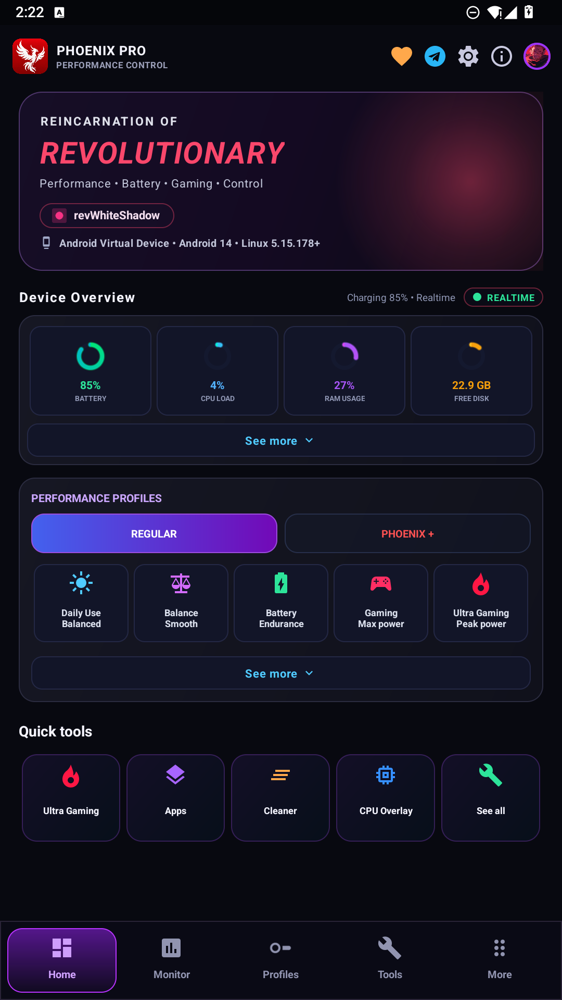 |  | 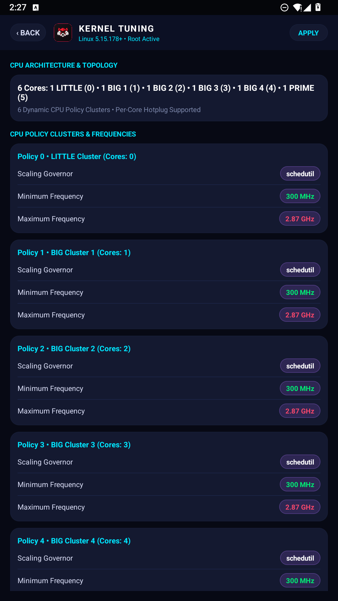 |

### Performance Profiles & Gaming Armory
| Performance Profiles | Phoenix Pro Profiles | 21-Tile Armory |
| :---: | :---: | :---: |
|  | 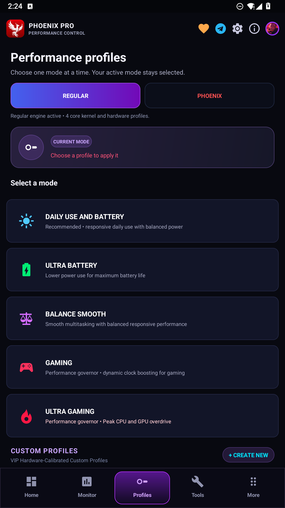 | 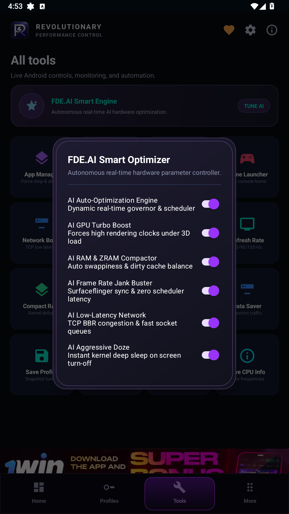 |

### Game Space & Telemetry HUD
| Game Space Console Launcher | Display Refresh & Game Library |
| :---: | :---: |
| 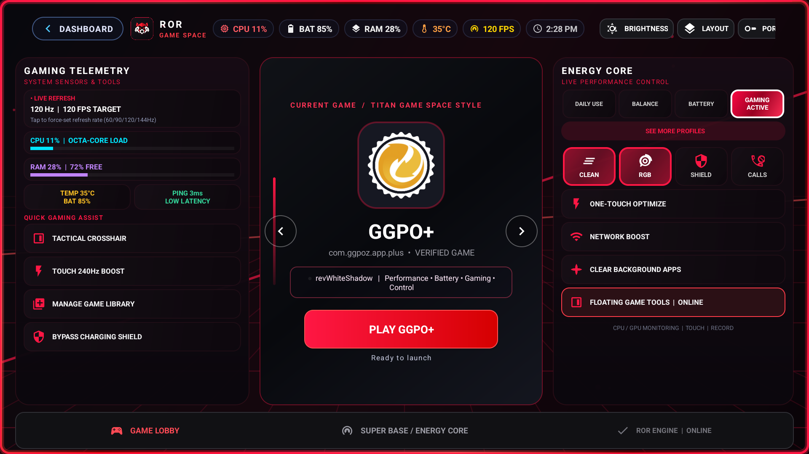 | 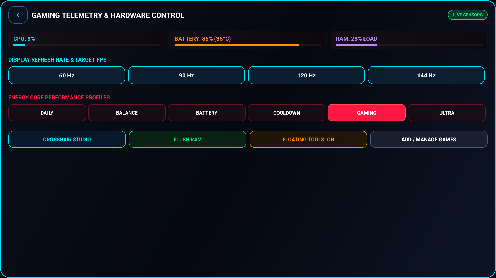 |

### Thermal Control & Hardware Utilities
| Charging Cooldown & Bypass | Battery & SOT Telemetry | Aim Boost Crosshairs |
| :---: | :---: | :---: |
| 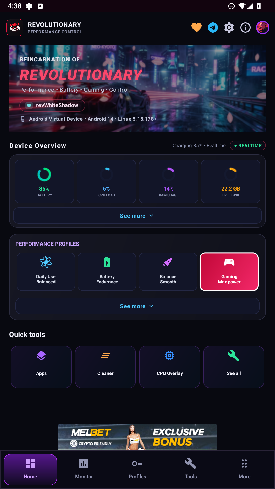 | 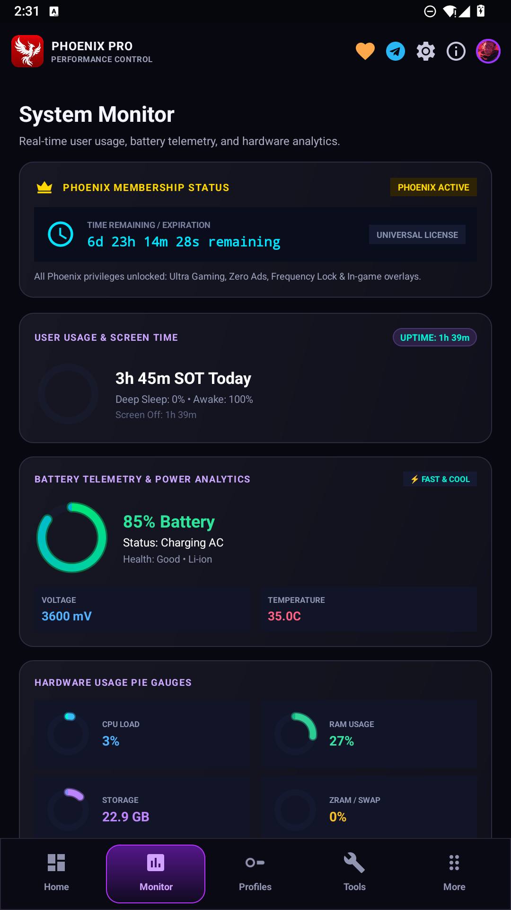 |  |

### System Settings & Official Source Navigation
| Real-Time AI Optimizer | Settings & Official Source Code Link |
| :---: | :---: |
| 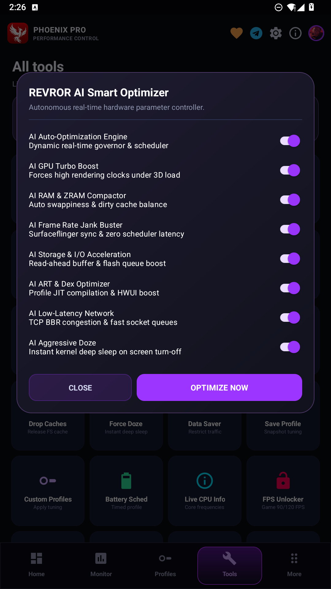 |  |

---

## 13. Android Compatibility

ROR is engineered with an adaptive, forward-compatible architecture designed to support **Android 10 all the way through Android 17 and all upcoming Android releases**:

| Android Version | API Level | Codename | Status | Notes |
| :--- | :---: | :--- | :---: | :--- |
| **Android 17+** | **37+** | *Future Android* | :white_check_mark: Full Forward Compatibility | Sysfs & LibSU isolation unaffected by userland changes |
| **Android 16** | **36** | Baklava | :white_check_mark: Fully Supported | 16 KB page-size support & GKI 6.6 kernel compatibility |
| **Android 15** | **35** | Vanilla Ice Cream | :white_check_mark: Fully Supported | Dynamic performance framework & Shizuku v13 IPC |
| **Android 14** | **34** | Upside Down Cake | :white_check_mark: Fully Supported | Native foreground service types & target SDK 34 |
| **Android 13** | **33** | Tiramisu | :white_check_mark: Fully Supported | Runtime notifications & per-app language support |
| **Android 12 / 12L** | **31 / 32** | Snow Cone / v2 | :white_check_mark: Fully Supported | Explicit component exports & splash screen engine |
| **Android 11** | **30** | Red Velvet Cake | :white_check_mark: Fully Supported | Scoped storage isolation & wireless ADB debugging |
| **Android 10** | **29** | Quince Tart | :white_check_mark: Fully Supported (`minSdkVersion 29`) | Legacy storage compatibility & dark theme primitives |

### Forward-Compatible Architecture
- **Hardware-Direct Sysfs Primitives**: Kernel nodes (`/sys/devices/system/cpu/`, `/sys/class/kgsl/`, `/sys/class/power_supply/`) operate directly on Linux kernel interfaces, making ROR immune to Android userland framework deprecations.
- **Universal Root Daemon**: Built on TopJohnWu's `libsu` IPC bridge, providing reliable, non-blocking superuser command execution across Magisk, KernelSU, and APatch on GKI kernels (4.14 through 6.6+).
- **Decoupled Shizuku Token Exchange**: Non-root capabilities interface directly with system binder tokens, eliminating reliance on internal hidden APIs.
- **Zero Maximum SDK Restrictions**: No artificial upper API ceilings are enforced, allowing ROR to launch and execute smoothly on bleeding-edge developer previews and upcoming Android releases.
- **Supported CPU Architectures**: `arm64-v8a` (64-bit ARM), `armeabi-v7a` (32-bit legacy), and `x86_64` (emulators & ChromeOS).
- **Tested SoCs**: Qualcomm Snapdragon (845 through 8 Gen 3/4), MediaTek Dimensity (700 through 9400), Google Tensor (G1 through G4), Samsung Exynos.

---

## 14. Root & Shizuku Requirements

ROR adapts seamlessly to your device's security environment:
- **Root Mode (Recommended for Full Power)**: Fully compatible with **Magisk v25+**, **KernelSU**, and **APatch**. Grants access to direct sysfs write, GPU clamping, and charging bypass.
- **Non-Root Mode (with Shizuku)**: Enables high refresh rate switching, system app optimizations, and Game Space overlays via standard Android Binder APIs.
- **Standard Non-Root**: Game Space, Floating Overlay, Aim Boost crosshair, and telemetry operate out of the box without special privileges.

---

## 15. Installation

Download the latest release package from our official distribution channels:
- Official Source Releases: [https://github.com/revws/ror/releases](https://github.com/revws/ror/releases)

Launch ROR and grant the required overlay and battery optimization permissions. If rooted, grant Superuser permissions when prompted to unlock complete kernel tuning and hardware controls.

---

## 16. GPL-3.0 License

This project is licensed under the **GNU General Public License v3.0 (GPL-3.0)**.
You are free to inspect, modify, and redistribute this software in accordance with the terms of the GPL-3.0 license.

*Note on Open-Source Distribution*: This public repository contains the modular source code and architectural components of ROR under GPL-3.0. Standalone build configurations and proprietary modules (such as specialized esports telemetry algorithms and Phoenix Pro binary assets) are decoupled and distributed exclusively through official compiled release packages.

---

## 17. Frequently Asked Questions

**Q: Does ROR require a custom kernel?**  
A: No. ROR works with stock vendor kernels as well as custom kernels. Custom kernels may expose additional governors and sysfs nodes.

**Q: Does ROR contain ads or background miners?**  
A: Absolutely not. ROR is 100% free of advertisements, tracking analytics, and background cryptocurrency miners.

**Q: Can I use Aim Boost in competitive online tournaments?**  
A: The Aim Boost module operates purely as a system window overlay and does not tamper with game packages. However, always review tournament-specific rules regarding custom crosshair overlays.

---

## 18. Developer Information & Credits

- **Lead Architect & Developer**: revWS (revWhiteShadow)
- **Technical Support**: [wahyu6070](https://github.com/wahyu6070) & [mshan](https://t.me/M_Shan_Op) and [frap129 for Spectrum](https://github.com/frap129/spectrum)
- **Telegram Contact**: [@revwhiteshadow](https://t.me/revwhiteshadow)
- **Ecosystem**: Reincarnation of Revolutionary (ROR)

---

## 19. Official Links

- **Official Source Repository**: [https://github.com/revws/ror](https://github.com/revws/ror)

- **Official Telegram Channel**: [https://t.me/godTspeed](https://t.me/godTspeed)
- **Discussion Community**: [https://t.me/godspeedmode](https://t.me/godspeedmode)
- **Architecture & Benchmark Article**: [articel.md](articel.md)
