<div align="center">

  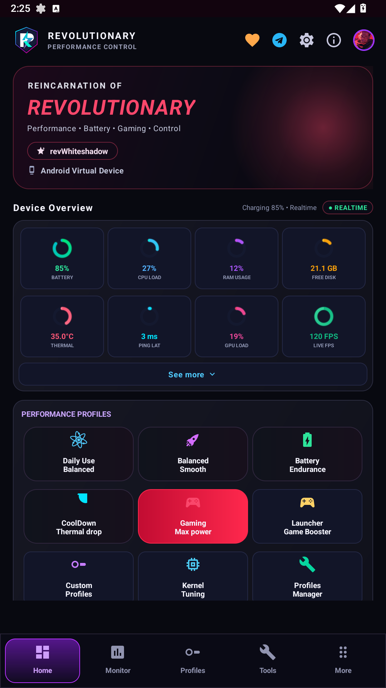

  # ⚡ REVROR — Reincarnation of Revolutionary ⚡
  ### 🎮 Next-Gen Android Performance Architecture • Esports Game Space • Linux Kernel Engine

  <p>
    <em>Engineered with passion for power-users, esports competitors, and Android enthusiasts by <strong>revWS</strong></em>
  </p>

  <p>
    <a href="https://t.me/godTspeed"></a>
    <a href="https://t.me/godspeedmode"></a>
    <a href="https://t.me/revwhiteshadow"></a>
  </p>

  <p>
    <a href="https://github.com/revws/rorexp"></a>
    <a href="https://developer.android.com/about/versions/14"></a>
    <a href="https://github.com/topjohnwu/Magisk"></a>
    <a href="https://github.com/RikkaApps/Shizuku"></a>
    <a href="#-license"></a>
    <a href="https://github.com/revws/rorexp"></a>
  </p>

  ---

  **[ 📖 Overview ](#-executive-overview)** • 
  **[ 📸 Gallery ](#-visual-showcase--previews)** • 
  **[ ✨ Features ](#-exhaustive-feature-architecture)** • 
  **[ 🔐 Privileges ](#-multi-tier-privilege-architecture)** • 
  **[ 🛡️ Security ](#️-open-source-security--intellectual-property-notice)** • 
  **[ 💬 Community ](#-community-support--official-links)**

</div>

---

### 🌐 Official Community & Ecosystem Hub
* 📢 **Official Announcement Channel**: [**@godTspeed**](https://t.me/godTspeed) — *Firmware releases, VIP configs & performance benchmarks*
* 💬 **Community Discussion Group**: [**@godspeedmode**](https://t.me/godspeedmode) — *Community gaming optimization chats & setup assistance*
* 👨‍💻 **Lead Architect & Developer**: [**@revwhiteshadow**](https://t.me/revwhiteshadow) — *Direct consultations & inquiries*
* 📦 **Official Release Downloads**: Available on [Telegram @godTspeed](https://t.me/godTspeed) and [GitHub Releases](https://github.com/revws/ror/releases)

---

## 📖 Executive Overview

> [!NOTE]
> **Reincarnation of Revolutionary (REVROR)** represents the pinnacle of modern Android system tuning, hardware telemetry, and competitive esports mobile gaming.

Crafted with an obsidian cyberpunk glassmorphic visual aesthetic, REVROR orchestrates Android userland services and deep Linux kernel subsystems (`sysfs`, `schedutil`, `devfreq`, `stune`) into a unified, zero-latency command center.

Whether deployed with full kernel root privileges (**Magisk / KernelSU / APatch**) or through non-invasive **Shizuku wireless debugging**, REVROR dynamically mitigates frame-time jitter, throttles background drainers, and unlocks true peak hardware performance without compromising stability or battery longevity.

---

## 📸 Visual Showcase & Previews

<div align="center">

### 🚀 Core Performance & Esports Deck

| 🎮 Cyberpunk Master Dashboard | 🚀 Console Trio Game Space | ⚡ GSM Profile Matrix |
| :---: | :---: | :---: |
| 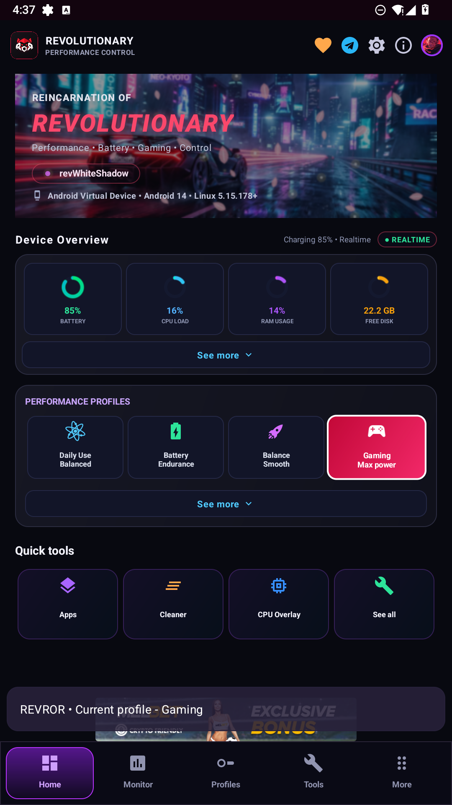 | 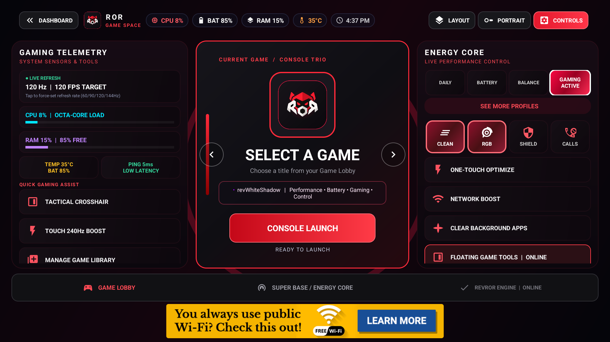 |  |
| *Real-Time Telemetry & Hardware Gauges* | *Esports Carousel & App Launch Deck* | *6-Tier Frequency Scaling Matrix* |

<br>

### 🎯 Tactical Gaming & Precision Armory

| 🔥 Ultra Gaming (Esports VIP) | 🎯 Tactical Crosshair Armory | 🔋 Energy & Power Tuning |
| :---: | :---: | :---: |
| 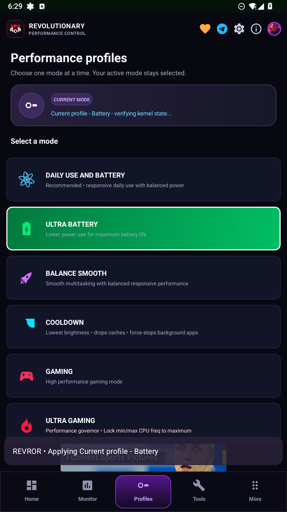 | 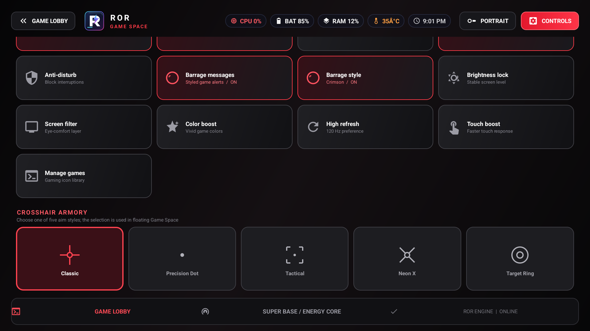 | 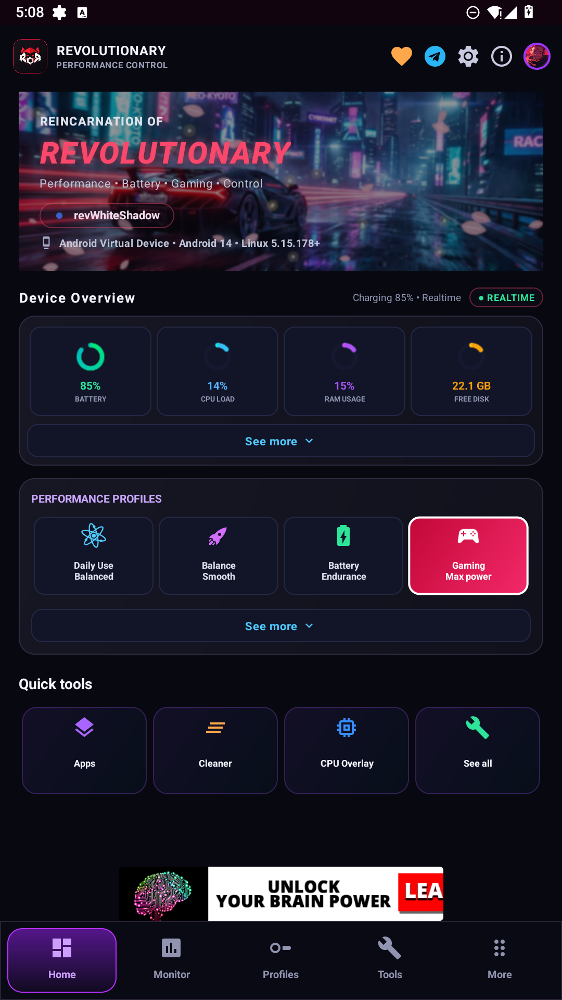 |
| *Hard Frequency Clamping & No-Throttle* | *Custom HUD Crosshairs & Colors* | *Aggressive Energy Mitigation* |

<br>

### ⚙️ Deep Tuning, AI Optimizer & Utilities

| ⚙️ Deep Kernel Tuning Suite | 🧠 REVROR AI Optimizer | 🧹 Auto Memory & Cache Cleaner |
| :---: | :---: | :---: |
| 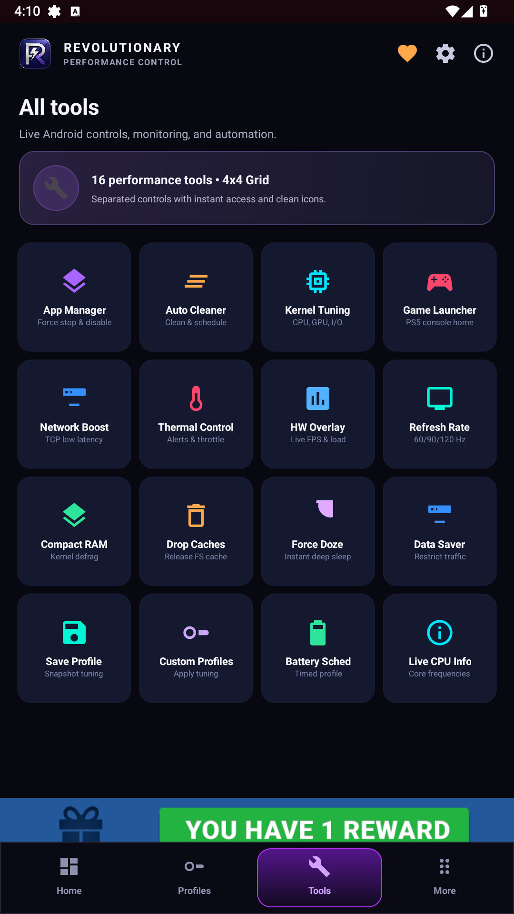 | 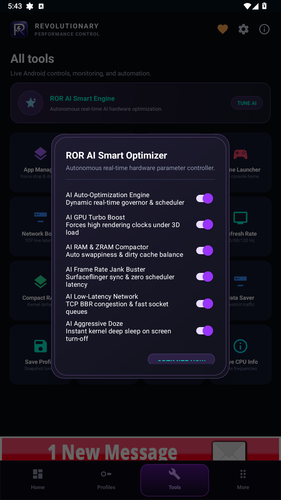 | 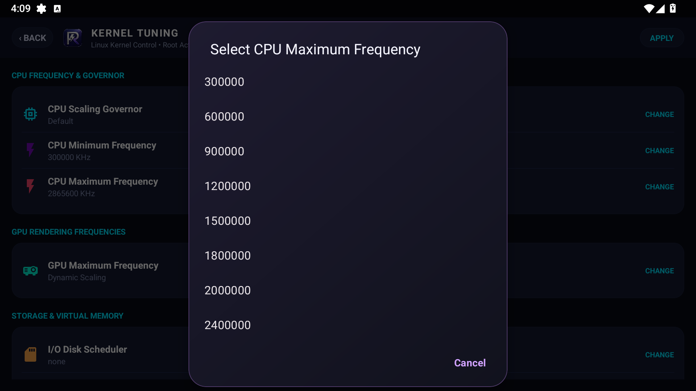 |
| *Governors, Swappiness, Schedulers* | *Auto Stutter & Thermal Mitigation* | *Scheduled System Cache Trimming* |

<br>

### 🛡️ SuperBase, Dynamic Themes & Telegram Hub

| 🛡️ SuperBase & System Tools | 🎨 Dynamic Wallpapers & Themes | 💬 Seamless Telegram Hub |
| :---: | :---: | :---: |
| 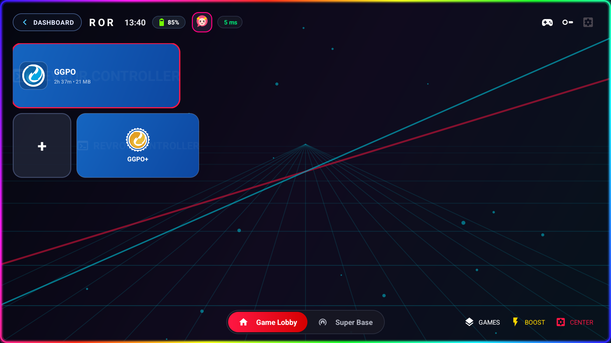 | 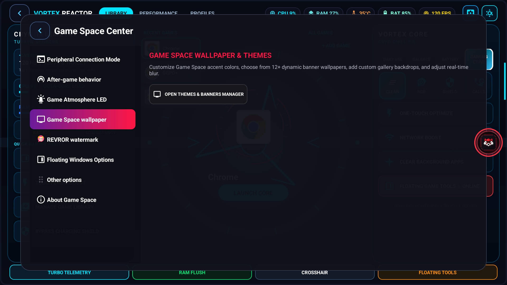 | 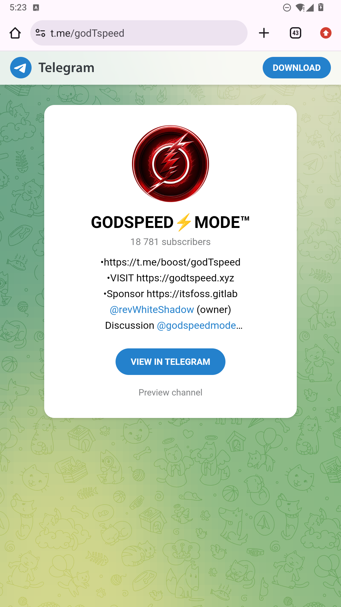 |
| *Encrypted DNS, Doze, FPS Unlocker* | *Obsidian & Synthwave Styles* | *Instant Updates & Community Access* |

</div>

---

## ✨ Exhaustive Feature Architecture

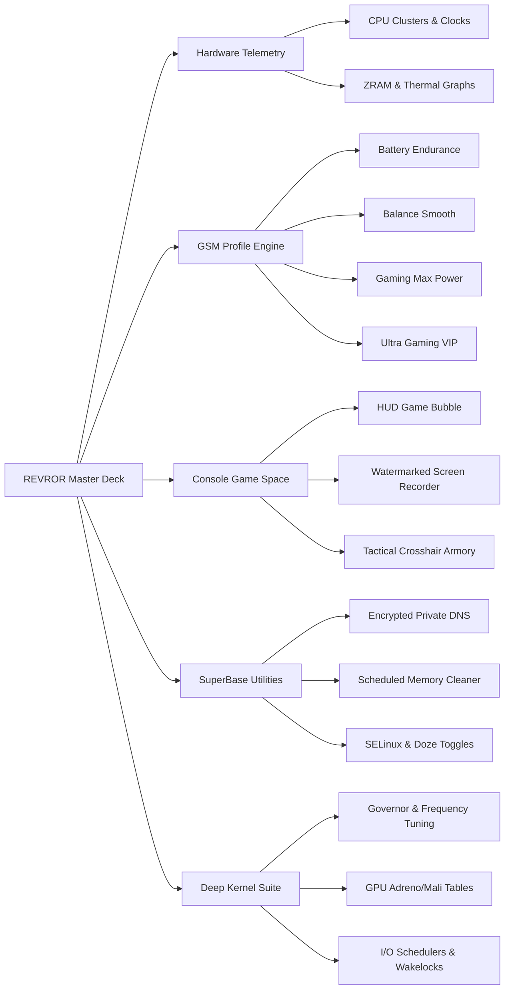

### 🎛️ 1. Real-Time Hardware Telemetry Matrix
* **Active Cluster Telemetry**: Real-time frequency readings across all CPU clusters (Efficiency, Performance, and Prime).
* **Ultra-Low Overhead Graphs**: Native custom-rendered canvas views (60/120 FPS) charting live per-second CPU load, thermal gradients, and memory allocation with near-zero CPU wake locks.
* **Storage & ZRAM Monitoring**: Instant live visualization of compressed ZRAM pressure, swap footprint, and NVMe/UFS read-write throughput.
* **Instant Master Toggles**: One-tap toggles for Android Doze mode, SELinux enforcement, I/O CRC verification, Network Data Saver, and PrintK kernel debugging logs.

### ⚡ 2. GSM Intelligent Performance Profiles
* 🔋 **Battery Endurance**: Power-efficient frequency scaling, energy-conserving CPU governors (`powersave` / `schedutil`), aggressive background app throttling.
* ⚖️ **Balance Smooth**: Silky everyday responsiveness with balanced thermals and progressive thermal mitigation.
* 🚀 **Gaming (Max Power)**: Governor touch-boost elevation, high clock rate baseline, zero thermal throttling.
* 🔥 **Ultra Gaming (Esports VIP)**: Hard frequency clamping to `scaling_max_freq`, governor priority (`performance` fallback to `schedutil`), fixed performance mode (`cmd power set-fixed-performance-mode-enabled true`), zero background interruptions.
* ❄️ **CoolDown**: Emergency thermal reduction dropping caches and idling aggressive clusters.
* 🛠️ **Daily Use**: Intelligent baseline tuning for daily social, productivity, and communication workloads.
* 🔄 **Automated Boundary Restoration**: Switching between profiles automatically unlocks CPU frequency clamps and restores default hardware scaling bounds cleanly.

### 🎮 3. Console Trio & Esports Game Launcher
* **Multi-Viewport Launcher Styles**: PS5 Horizon, Cyberpunk Arcade, and Console Trio viewports with dynamic wallpaper backdrops, game discoverability, and custom banners.
* **Floating In-Game HUD (`GameBubbleService`)**:
  * **Quick In-Game Profile Switching**: Switch between Battery, Balance, Gaming, and Ultra Gaming on the fly with distinct profile color illumination.
  * **Tactical Crosshairs**: Multiple HUD crosshairs with real-time size, color, and opacity configuration.
  * **Display Enhancements**: Live saturation, contrast, and night-vision game filters applied strictly when the game is in foreground.
  * **Built-In Screen Recorder with Watermark**: High-bitrate screen recording (1080p, 720p, 480p) featuring the official ROR logo watermark and automatic MediaStore indexing for instant discovery in any File Manager or Gallery.
  * **Floating Mini Apps & Multi-Window**: Launch companion guides, calculators, stopwatches, or any installed application in resizable floating windows.

### 🧠 4. REVROR AI Intelligent Engine
* Real-time thermal gradient and memory allocation rate monitoring.
* Dynamically manages governor touch-boost parameters, task scheduler affinity, and virtual memory dirty ratios.
* Completely eliminates micro-stutters and sudden FPS drops during prolonged competitive matches (PUBG, COD, Free Fire, Genshin Impact, MLBB).

### 🛡️ 5. SuperBase & System Armory
* **Encrypted Private DNS Changer**: Instantly route DNS traffic through Cloudflare (1.1.1.1), Google DNS (8.8.8.8), AdGuard (ad-blocking), NextDNS, Quad9, CleanBrowsing, or custom DoT endpoints.
* **Scheduled Auto Cleaner (`CleanupReceiver`)**: Automated background maintenance purging stale app caches, orphan APKs, tombstone crash logs, and thumbnail databases.
* **FPS Unlocker**: Inject hardware display overrides and configure target screen refresh rates up to 120Hz/144Hz.
* **Floating Hardware Overlay**: Non-intrusive desktop overlay showing per-cluster frequencies, temperatures, and real-time FPS.
* **App Manager & Process Guard**: Freeze/disable bloatware, force-stop background drainers, and configure per-app network and power boundaries.

### ⚙️ 6. Deep Linux Kernel Tuning Suite
* **CPU Tuning**: Cluster-by-cluster governor tuning, frequency ceiling/floor configuration, and Devfreq/Dynamic Stune boosts.
* **GPU & Thermal Controls**: Adreno/Mali frequency table controls, governor selection, and thermal engine throttle thresholds.
* **Memory & Storage**: Swappiness percentages, VFS cache pressure, dirty ratios, ZRAM disk size tuning, and I/O schedulers (Maple, BFQ, Zen, CFQ, FIOPS).
* **Wakelock Blocker**: Block battery-draining kernel and driver wakelocks with boot persistence.

---

## 🔐 Multi-Tier Privilege Architecture

REVROR operates adaptively across all permission tiers:

| Feature / Capability | Standard (Unrooted) | Shizuku (Wireless Debugging) | Root (Magisk / KSU / APatch) |
| :--- | :---: | :---: | :---: |
| Live CPU, RAM & Battery Telemetry | ✅ | ✅ | ✅ |
| Floating Game Space & Crosshairs | ✅ | ✅ | ✅ |
| Floating Mini Windows & Multi-Apps | ✅ | ✅ | ✅ |
| In-Game Screen Recorder & Watermark | ✅ | ✅ | ✅ |
| App Freeze / Disable / Force-Stop | ❌ | ✅ | ✅ |
| System Refresh Rate & Resolution Override | ❌ | ✅ | ✅ |
| Android Doze & Data Saver Policies | ❌ | ✅ | ✅ |
| CPU Frequency Min/Max Clamping | ❌ | ❌ | ✅ |
| CPU & GPU Governor Switching | ❌ | ❌ | ✅ |
| Proprietary GSM Hardware Daemon | ❌ | ❌ | ✅ |
| Kernel Sysfs, I/O & Memory Tuning | ❌ | ❌ | ✅ |

---

## 🛡️ Open Source Security & Intellectual Property Notice

This repository contains the official open-source presentation, architectural layouts, resource definitions, UI components, and privilege orchestration layers of REVROR under the **GNU General Public License v3.0 or later (GPL-3.0-or-later)**.

> [!IMPORTANT]
> **Anti-Plagiarism & Security Hardening Policy:**
> - To safeguard against malicious repackaging, clone-and-monetize piracy, and rogue clones, proprietary compiled binaries (`assets/library`), internal verification modules, and official signing keystores (`*.keystore`, `*.jks`) are strictly excluded from public repository trees.
> - Automated build wrappers (`gradlew`) and private submodule dependencies (`:scommon-*`, `:seekbar`) are intentionally decoupled from the public showcase.
> - The application runtime integrity is guarded by cryptographic package and signature assertions against unauthorized modifications.
> - **End-Users:** Please always download certified, signed, and malware-scanned APKs directly from the [Official Telegram Channel](https://t.me/godTspeed) or [GitHub Releases](https://github.com/revws/ror/releases).

---

## 📂 Project Architecture Showcase

```
open-source-without-exposing-main-codes/
├── app/
│   ├── src/main/
│   │   ├── java/com/revror/kernelmanager/
│   │   │   ├── activities/        # DashboardActivity, GameLauncherActivity, KernelTuningActivity, etc.
│   │   │   ├── services/          # GameBubbleService, CpuOverlayService, ScreenRecorderService
│   │   │   ├── utils/             # GsmProfileManager, GameOptimizer, ShizukuBridge, DnsChanger
│   │   │   ├── views/             # RealtimeSparklineView, RealtimePieGraphView, FloatingDraggableView
│   │   │   └── RevrorApp.java     # Application life-cycle & state coordinator
│   │   ├── res/                   # Obsidian cyberpunk styles, layouts, drawables, animations
│   │   └── AndroidManifest.xml    # Permissions, activities, receivers, and service declarations
│   └── build.gradle               # Gradle build configuration
├── docs/
│   └── screenshots/               # High-resolution visual showcase captures
├── change-logs.md                 # Detailed version release notes
├── featuersv2.md                  # Comprehensive functional feature specification
├── OPEN_SOURCE_SECURITY.md        # Security, privilege architecture & build verification policy
├── LICENSE                        # GNU General Public License v3.0
└── README.md                      # Official project documentation
```

---

## 🤝 Community, Support & Official Links

Join our growing community for daily tuning guides, esports configurations, and update notifications:

* 📢 **Telegram Channel & Releases**: [@godTspeed](https://t.me/godTspeed)
* 💬 **Telegram Community Discussion**: [@godspeedmode](https://t.me/godspeedmode)
* 👨‍💻 **Lead Developer**: **revWS** ([Telegram @revwhiteshadow](https://t.me/revwhiteshadow))
* ☕ **Ko-fi Support**: [ko-fi.com/revWS](https://ko-fi.com/revWS)
* 💰 **Cryptocurrency Contributions**:
  * **Binance Pay ID**: `113486850`
  * **USDT (TRC20)**: `TDu77Susy3CzbkJGAjPRCGiVt5obBzypRb`
  * **USDT (BEP20 / ERC20)**: `0x18d45134688d047f6fc52969980fc8c13f796508`

---

## 📄 License

REVROR is licensed under the **GNU General Public License v3.0 or later (GPL-3.0-or-later)**.  
See the [LICENSE](LICENSE) file for the full terms and conditions.

<p align="center">
  <em>Crafted with relentless passion & precision by <strong>revWS</strong>.</em>
</p>
